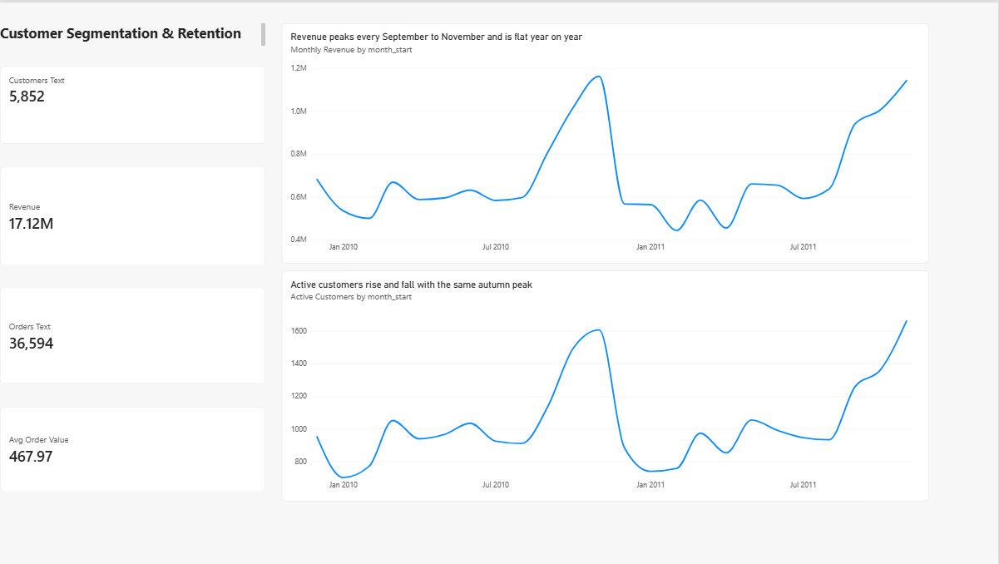
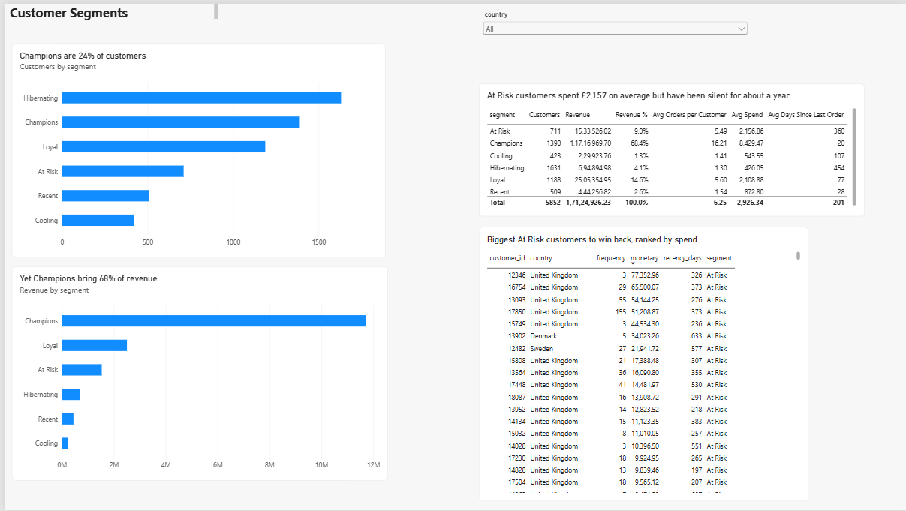
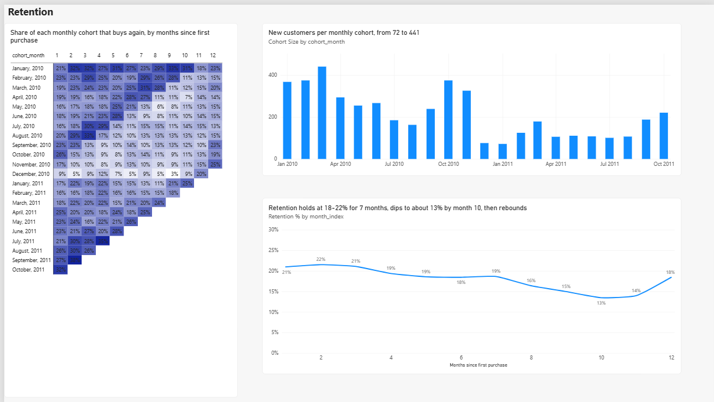

# Customer Segmentation & Retention Analysis (RFM + Cohorts)

**Author:** Akriti Kushwaha · [LinkedIn](https://www.linkedin.com/in/akritikushwaha) · [GitHub](https://github.com/AkritiTech) · akritikushwahaneha@gmail.com
**Tools:** MySQL 8, Power BI, Python (data preparation only) · **Skills shown:** CTEs, window functions (NTILE, LAG, FIRST_VALUE, ROW_NUMBER), views, RFM scoring, cohort analysis, dashboard design





## The question

A UK online gift wholesaler wants to know who its valuable customers are, who it is losing, and whether new customers come back. I answered it with three pieces of analysis: RFM segmentation (how recently, how often and how much each customer buys), a cohort retention analysis, and a look at how revenue depends on repeat buying.

## Data

Online Retail II (UCI Machine Learning Repository), as shared on [Kaggle](https://www.kaggle.com/datasets/cemalcici/online-retail-ii-uci-two-peroid): every line item sold by the retailer between 1 December 2009 and 9 December 2011. Currency is GBP.

I prepared the data with `prep/prepare_invoices.py`, which turns 1,067,371 line items into one row per invoice (`data/invoices.csv`, 43,876 rows) so it loads into MySQL quickly:

- The two source files both contain 1 to 9 December 2010. Those 22,523 identical rows were kept once.
- 235,287 rows (22.5%) have no Customer ID and were dropped, because RFM needs a customer.
- 3,673 non-product lines (postage, manual adjustments, bank charges, discounts, test codes) and 60 zero-price lines were dropped. Product codes start with five digits.
- Cancelled invoices (numbers starting with C) are kept as returns and excluded from sales and segmentation.

The raw CSV files are not in this repository (about 90 MB). Download them from the Kaggle link above.

## What I found

**1. The business is flat and very seasonal.** Revenue for January to November was £7.68M in 2010 and £7.68M in 2011, so there was no growth. September to November brings 39% to 40% of that revenue. November 2010 was £1.16M and December 2010 fell to £0.57M.

**2. A small group of customers pays for everything.** The top 10% of customers by spend account for 63.8% of revenue, and the top 20% for 77.1%. The 1,390 Champions (23.8% of customers) generate 68.4% of revenue.

**3. Repeat buying is the business.** 86.0% of revenue comes from repeat orders and only 14.0% from customers' first orders.

**4. Most new customers do not come back quickly.** Of 4,305 new customers, 1,761 (40.9%) bought again on a later day within 90 days, so 59.1% did not.

**5. About one in five new customers keeps buying, and the share fades slowly.** Share of a cohort still buying: 21.0% one month after the first month, 21.5% at two, 21.1% at three, then between 13.5% and 19.4% in months 4 to 12. The curve is uneven (month 10 is the low at 13.5%, month 12 is back at 18.4%), probably because the cohorts counted differ from month to month and sales are seasonal. It is a gentle decline, not a collapse.

**6. There is a win-back pool, but it is old.** 711 At Risk customers (12.1%) spent £1.53M with the company and average 5.5 orders each, but their last order was 360 days ago on average. 1,631 Hibernating customers (27.9%) account for only 4.1% of revenue.

**7. Returns and country mix.** Returns are 4.2% of sales (£713K). The UK is 83.8% of revenue. Ireland (EIRE) has only 3 customers yet 3.4% of revenue, so a few wholesale accounts matter a lot.

| Segment | Customers | % of customers | Revenue | % of revenue | Avg orders |
|---|---|---|---|---|---|
| Champions | 1,390 | 23.8% | £11.72M | 68.4% | 16.2 |
| Loyal | 1,188 | 20.3% | £2.51M | 14.6% | 5.6 |
| At Risk | 711 | 12.1% | £1.53M | 9.0% | 5.5 |
| Hibernating | 1,631 | 27.9% | £0.69M | 4.1% | 1.3 |
| Recent | 509 | 8.7% | £0.44M | 2.6% | 1.5 |
| Cooling | 423 | 7.2% | £0.23M | 1.3% | 1.4 |

## How the segments are defined

Recency and spend are scored 1 to 5 with `NTILE(5)` (5 is best). Frequency uses fixed bands (1, 2, 3 to 4, 5 to 9, 10 or more orders), because over a quarter of customers have exactly one order and `NTILE` would split identical customers into different scores. Customers with equal values are ordered by customer ID so the results are repeatable.

| Segment | Rule (last order = days before 10 Dec 2011) |
|---|---|
| Champions | Last order within about 59 days, 5 or more orders |
| Loyal | Within 59 days with 3 to 4 orders, or 60 to 187 days with 3 or more orders |
| Recent | Within 59 days, 1 to 2 orders |
| Cooling | 60 to 187 days, 1 to 2 orders |
| At Risk | More than about 187 days, 3 or more orders |
| Hibernating | More than about 187 days, 1 to 2 orders |

## Dashboard

Three Power BI pages built on CSV exports of three SQL views (`v_rfm_customers`, `v_cohort_retention`, `v_monthly`):

- **Overview:** customers, revenue, orders and average order value; monthly revenue; active customers per month.
- **Customer Segments:** customers and revenue by segment, a segment summary table with a country filter, and the At Risk customers ranked by spend.
- **Retention:** cohort retention heatmap for months 1 to 12, average retention by month, and the size of each monthly cohort.

File: `powerbi/retention-dashboard.pbix`

## Recommendations

1. **Protect the Champions.** 1,390 customers carry 68.4% of revenue. Give them a named contact and review any Champion who drops to Loyal or Cooling.
2. **Run a measured win-back on At Risk customers.** Start with the highest spenders (query Q8 lists the top 15) and hold back half of them as a control group, so the result shows whether the campaign worked. Expect modest results: their average last order was a year ago.
3. **Work on the second order.** 59.1% of new customers do not return within 90 days. Test a follow-up within the first 30 days and compare against the 40.9% baseline.
4. **Plan the year around September to November.** That window holds roughly 40% of January to November revenue, so stock and campaigns should be ready by September.
5. **Do not spend on Hibernating customers.** 27.9% of customers bring 4.1% of revenue.

## Limitations

- Customers are mostly businesses (average spend £2,926, 6.3 orders each), so these results describe a wholesale customer base, not shoppers.
- 22.5% of line items have no Customer ID, so the analysis covers registered customers only.
- The data starts in December 2009, so customers first seen that month include people who had bought before. They are left out of the new-customer and cohort measures.
- December 2011 has only nine days, so monthly and retention queries stop at 30 November 2011.
- 11,812 exact duplicate lines inside invoices were kept, since two scans of the same item are possible.
- Returns are reported separately and not subtracted from customer spend.
- Segments are rules on past behaviour, not a prediction, and there is no control group for any recommendation.

## Repository

```
├── prep/prepare_invoices.py     cleans the raw files into one row per invoice
├── data/invoices.csv            43,876 invoices (the only table used)
├── sql/
│   ├── 01_schema_and_load.sql   database, table, loading instructions
│   └── 02_analysis.sql          12 queries and 4 views, each with its question
├── powerbi/retention-dashboard.pbix   Power BI dashboard
├── images/                      dashboard screenshots
└── README.md
```

## How to run

1. In MySQL 8+, run `sql/01_schema_and_load.sql`, then load `data/invoices.csv` into the `invoices` table (Workbench Table Data Import Wizard).
2. Run `sql/02_analysis.sql`. The views `v_rfm_customers`, `v_cohort_retention` and `v_monthly` feed the dashboard.
3. Open `powerbi/retention-dashboard.pbix` in Power BI Desktop to explore the dashboard.
4. To rebuild `data/invoices.csv` from the raw files: `python prep/prepare_invoices.py <raw_folder> data/invoices.csv`.
